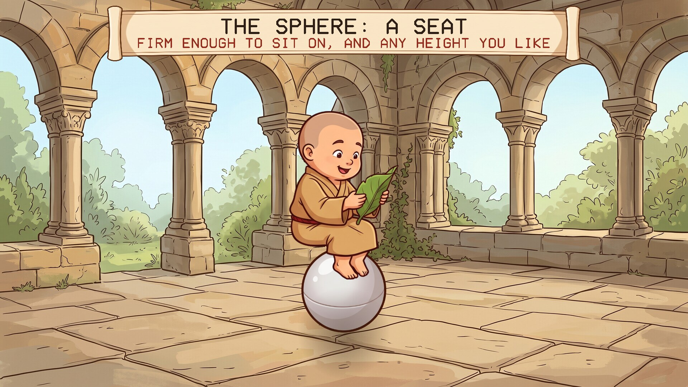
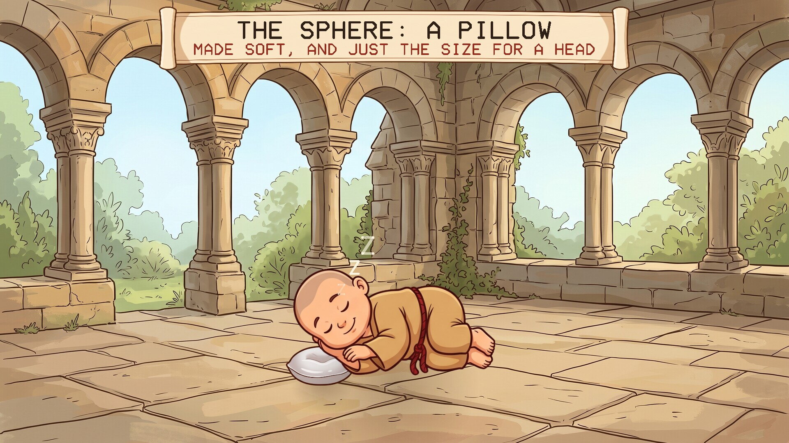
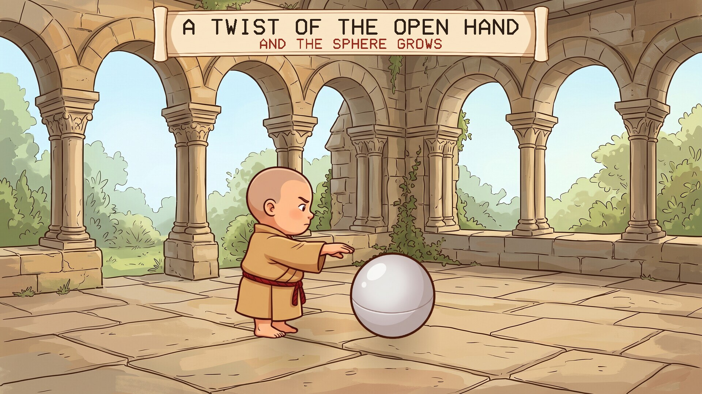
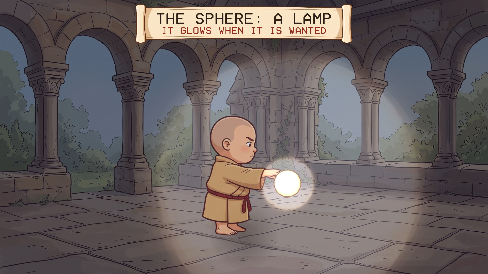
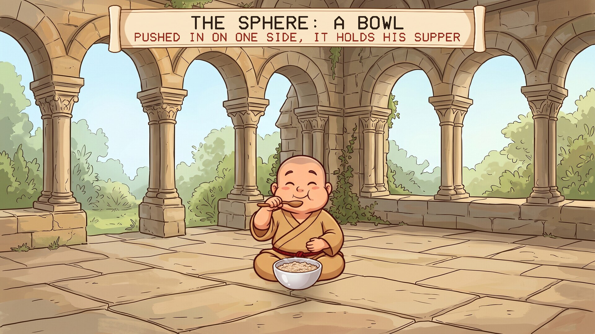
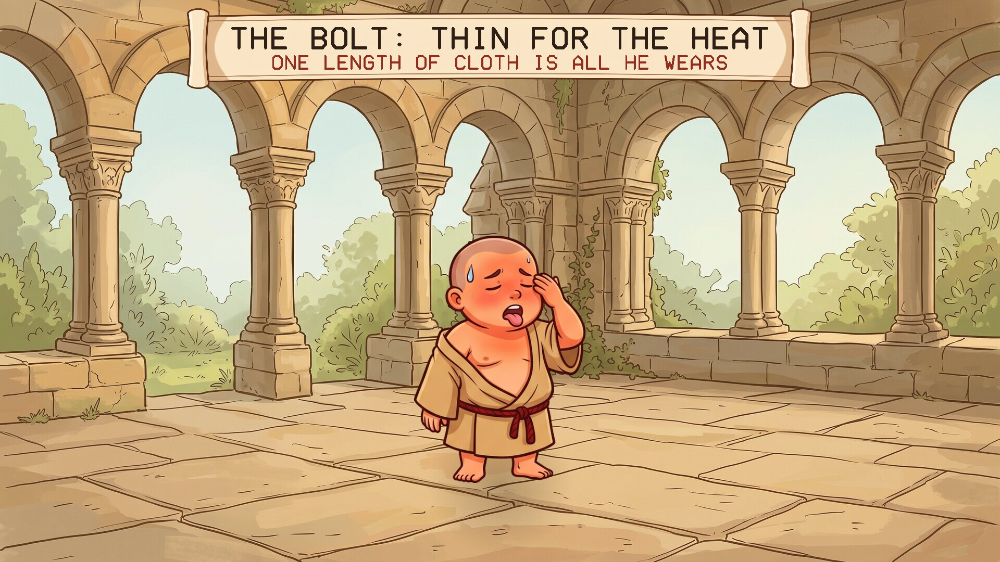
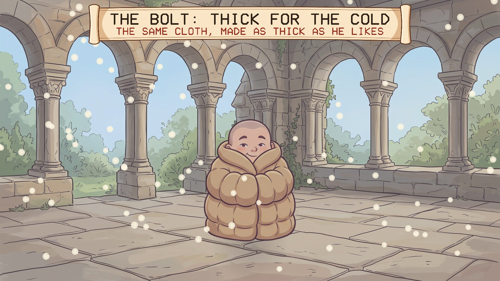
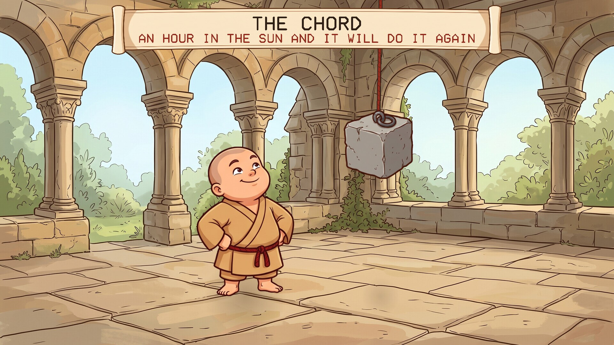
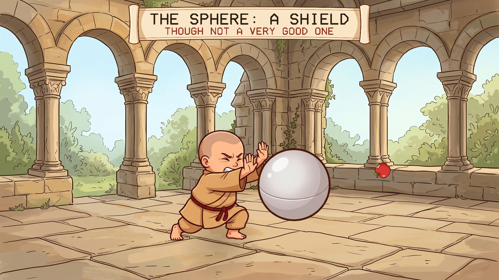

# Bolt, Chord and Sphere

A screensaver of the three things an avout owns, from Neal Stephenson's novel
*Anathem*. Runs on Linux, Windows and macOS.

## The three things

An avout may own a bolt, a chord and a sphere, and nothing else. All three are made
of newmatter, which can be told to change.

- **The sphere** can be any size from a pill to several feet across, and anything
  from rigid to soft. A twist of the open hand on it makes it grow.
- **The bolt** is a length of cloth and the only garment. It is wrapped and folded
  in many ways, and can be made thicker or thinner to suit the weather.
- **The chord** holds the bolt on. It can also shorten itself, hard enough to lift a
  heavy load, and takes its strength back from sunlight.

## What the screensaver shows

One small fraa in a corner of the cloister, in eight scenes of about thirteen
seconds each:

| | |
|---|---|
|  |  |
| The sphere as a pillow | A twist of the hand and it grows |
|  |  |
| A lamp | A bowl |
|  |  |
| The bolt thin for the heat | And thick for the cold |
|  |  |
| The chord lifting a stone | A shield, though not a very good one |

Then the sphere shrinks to a pill, goes into a fold of his bolt, and he sets off
down the road.

### What is from the book and what is mine

From the book: that these are the three things, what each can do, the twist of the
open hand that makes a sphere grow, and each of the uses shown.

Mine: the fraa, the scenes, the apples, and the block of stone.

## Install

Packages are on the [releases page](../../releases).

### Windows

Run `BoltChordSphere-Setup-1.0.1.exe`. It asks for administrator rights, because Windows
only lists screensavers that are in its own system folder. After that "Bolt, Chord and Sphere" is in Screen Saver Settings with the others, already selected. Uninstall from
Apps.

### macOS

There are two downloads on the releases page, for Apple Silicon and Intel, macOS 11
or later.

**The screen saver** is the file ending `-mac-screensaver.zip`. Unzip it and
double-click the `.saver` file; macOS offers to install it. Then choose it in System
Settings, Screen Saver (scroll to the end of the list, under Other).

**The app** is the file ending `-mac.zip`: the same thing as an ordinary program
that runs full screen until you press a key.

Neither is signed with an Apple developer certificate, so macOS will refuse them at
first. After the refusal, open System Settings, Privacy & Security, scroll down,
and click Open Anyway. If the screen saver still will not load, clear the
quarantine mark in Terminal:

    xattr -dr com.apple.quarantine ~/Library/"Screen Savers"

Both are built on a Mac build machine, where the screen saver is loaded and made to
draw as a test. They have not yet been tried by a person on a real Mac, and screen
savers on recent macOS are known to be temperamental; reports are welcome.

### Linux

**Fedora, Nobara** (built on Fedora 44):

    sudo dnf install ./bolt-chord-sphere-1.0.1-1.fc44.x86_64.rpm

**Debian, Ubuntu, Mint** (Ubuntu 24.04 / Debian 13 or later):

    sudo apt install ./bolt-chord-sphere_1.0.1_amd64.deb

From your next login it starts by itself after five minutes idle, and any key or
mouse movement ends it. To start the watcher without logging out, or to change the
delay:

    bolt-chord-sphere-screensaver enable 10    # after 10 minutes idle
    bolt-chord-sphere-screensaver disable
    bolt-chord-sphere-screensaver status
    bolt-chord-sphere-screensaver now          # run it right away

Wayland desktops have no screensaver service to plug into, so the package starts a
small idle watcher (`swayidle`) at login. It works on compositors that provide the
ext-idle-notify protocol: KDE Plasma, Sway, Hyprland, niri, COSMIC, labwc and
others. GNOME does not provide it, and on X11 you would add `bolt-chord-sphere` to
xscreensaver or your desktop's own idle settings. It does not lock the screen. If
one of the other *Anathem* screensavers
([Teglon](https://github.com/mottipython/teglon),
[the Lazy Peregrin](https://github.com/mottipython/lazy-peregrin),
[Cutting the Cake](https://github.com/mottipython/cutting-the-cake),
[the Clock of Saunt Edhar](https://github.com/mottipython/edhar-clock),
[the Weed War](https://github.com/mottipython/weed-war),
[the Daban Urnud](https://github.com/mottipython/daban-urnud),
[the Adrakhonic Theorem](https://github.com/mottipython/adrakhonic),
[the Analemma](https://github.com/mottipython/analemma)) is already on screen it stays out of the way.

## Running it yourself

    bolt-chord-sphere              full screen on every display; any key or mouse movement quits
    bolt-chord-sphere --window     in a window; Esc or Q quits
    bolt-chord-sphere --speed 2    faster
    bolt-chord-sphere --snapshot out.bmp --time 60 --size 1920x1080

## Building

Needs a C compiler, make and SDL2 (2.0.18 or newer). Build from the top of the
source tree, because the pictures in `assets/art` are built into the program.

    make
    make check
    sudo make install

Packages are written to `dist/`. `tools/Containerfile` describes a container with
everything they need:

    podman build -t anathem-build -f tools/Containerfile tools
    podman run --rm --security-opt label=disable -v "$PWD":/src -w /src anathem-build make dist

## Credits and licence

MIT. *Anathem*, and the bolt, chord and sphere, are Neal Stephenson's; this is an
unofficial fan project.

The pictures (the fraa, the sphere and the other things, the cloister and the
scroll) were drawn with Google Gemini and prepared by `tools/make_sprites.py`.
Images are decoded with [stb_image](https://github.com/nothings/stb) (public
domain).
